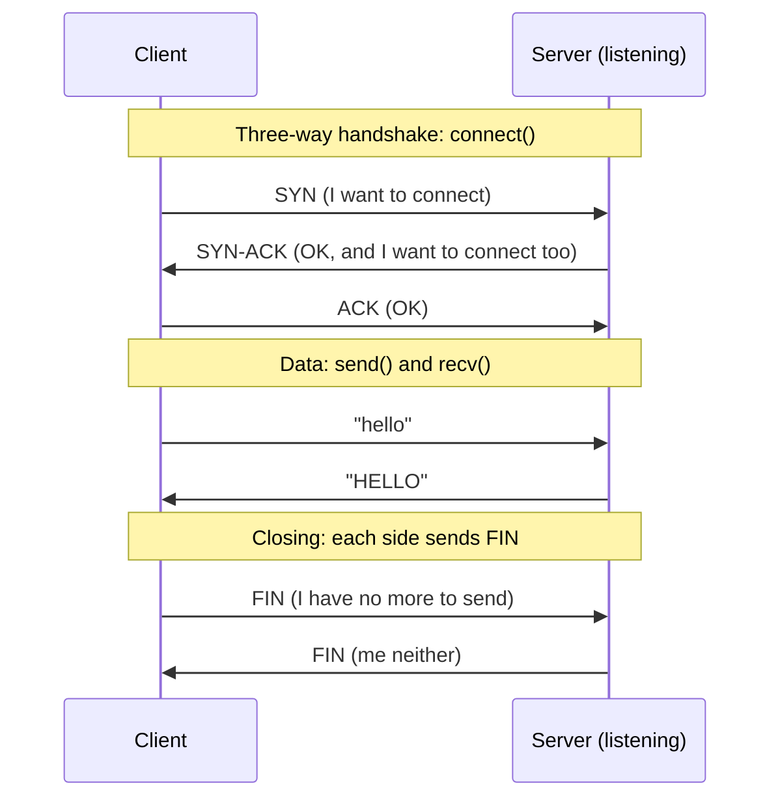

# 01 - TCP

**The idea:** TCP gives two programs a reliable two-way pipe of bytes. The network below it can lose,
repeat or reorder packets. TCP hides that by numbering bytes and resending what gets lost.

A connection is identified by four values: **client IP, client port, server IP, server port**.



## Run it

Terminal 1:
```
python 01-tcp/tcp_server.py
```
Terminal 2:
```
python 01-tcp/tcp_client.py
```

Look at "my end": the operating system picked a temporary port for the client. Run the client again and
the port usually changes. The server's port stays 9001.

## TCP has no messages

```
python 01-tcp/stream_demo.py
```

This surprises almost everyone. Three sends can arrive as one blob, and one send can arrive in pieces.
Programs must agree on where a message ends. HTTP's blank line and `Content-Length` (lesson 03) do
exactly that.

## How connections fail

```
python 01-tcp/connect_errors.py
```

| Result | What happened | Usual cause |
|---|---|---|
| Refused | The machine answered "no" (RST) | Service not running, or wrong port |
| Timed out | No answer at all | Firewall dropping packets, wrong IP, no route |
| DNS failure | The name has no IP | Typo, missing DNS record |
| Connection reset | It worked, then one side cut it off (RST) | Program crashed, or a proxy or firewall cut it |

**Refused vs. timed out is the most useful clue in networking.** Refused normally means you reached the
machine. Timed out means nobody answered. (Some firewalls send a refusal themselves.)

## Try it

1. Start the client without the server. Which error do you get?
2. Start the server twice. Why does the second one fail?
3. While the server runs, list listening ports. Windows: `netstat -ano | findstr 9001`. Linux: `ss -tln`.
4. In `tcp_server.py` change `recv(1024)` to `recv(3)`. What does the server print now?

## Common doubts

**What is a port?** An IP address finds the machine. A port finds the program on it. By convention HTTP
uses 80, HTTPS 443, DNS 53 and SSH 22.

**How can a server handle many clients on one port?** Each client has a different IP or port, so the
four values differ, so each is a separate connection.

**127.0.0.1 or 0.0.0.0?** Listening on 127.0.0.1 accepts only this computer. 0.0.0.0 accepts connections
on every network interface. "Works locally but not from outside" is often this.

**Does a successful `sendall()` mean the other program got the data?** No. It only means your operating
system took the data. Only a reply from the other program proves that it was received.
