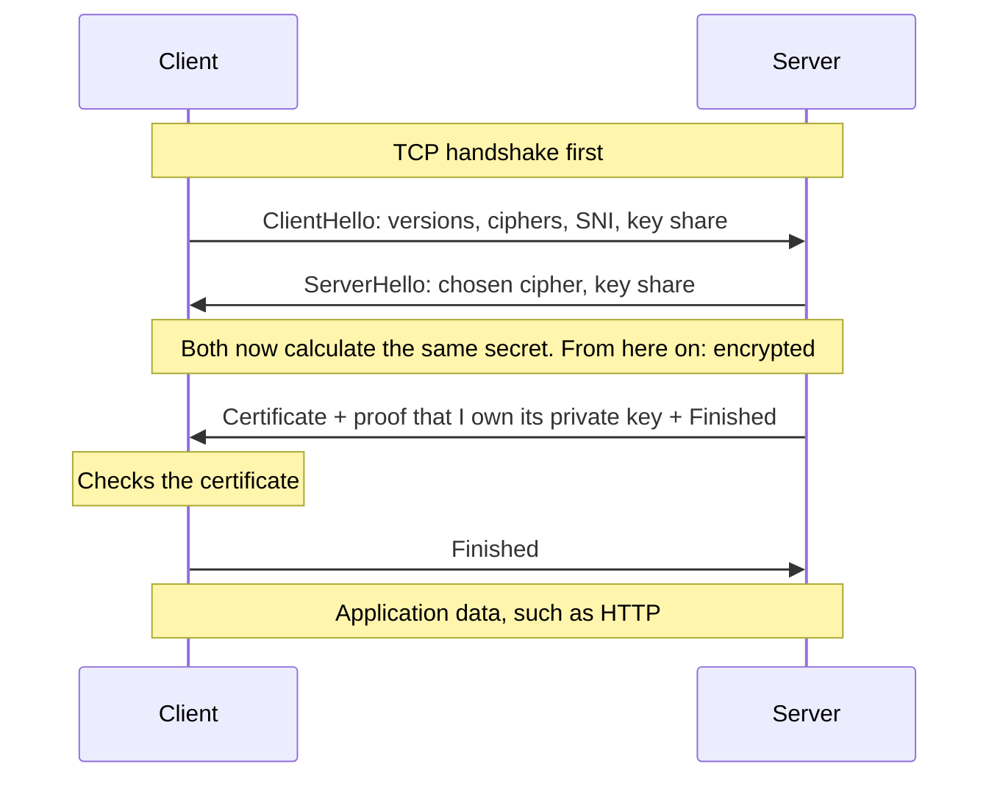

# 04 - TLS and certificates

**The idea:** TLS is a protective layer between TCP and your application. It gives you:

1. **Privacy:** others cannot read the data.
2. **Integrity:** others cannot change the data unnoticed.
3. **Identity:** the server proves that it owns the name you asked for.

"SSL" is the old name. SSL itself is obsolete; today it is TLS 1.2 or TLS 1.3.


(This is TLS 1.3. In TLS 1.2 the certificate is sent unencrypted.)

## Run it

If `python tools/check_setup.py` reported INTERCEPTED, use WSL for this lesson (see the
[main README](../README.md#setup)).

Terminal 1:
```
python 04-tls/tls_server.py
```
Terminal 2:
```
python 04-tls/tls_client.py
```

Compare `tls_server.py` with the TCP server of lesson 01. The new parts are loading a certificate and
calling `wrap_socket`.

## How a client checks a certificate

| Check | Failure looks like |
|---|---|
| Was it signed by a CA I trust? | `unable to get local issuer certificate` |
| Is the name I wanted in its SAN list? | `Hostname mismatch` |
| Is today between its start and end dates? | `certificate has expired` |

Cause each failure on purpose:
```
python 04-tls/cert_failures.py
```

## Where certificates come from

```
1. Create a private key                    (keep it secret)
2. Create a CSR: "please certify this key for alpha.test"
3. A CA checks that you own the name, and signs
4. You install the certificate + private key on the server
```

[tools/make_certs.py](../tools/make_certs.py) does this with our own lab CA. Normally the chain is longer:

```
Root CA  (already on your computer)
  └── Intermediate CA  (sent by the server)
        └── Server certificate  (sent by the server)
```

A common mistake is a server that forgets the intermediate. Browsers may hide it, while curl and Python
fail with `unable to get local issuer certificate`.

## Try it

1. Read a certificate: `openssl x509 -in certs/alpha.test.crt -noout -text`
   (In PowerShell, use Git Bash or WSL if `openssl` is not found.)
2. Inspect a real site: `openssl s_client -connect example.com:443 -servername example.com`.
   Look for the certificate chain. Press Ctrl+C to leave.
3. Click the lock or settings icon beside the address in a browser and view the certificate.
4. Spy on TLS. With `tls_server.py` running, start `python tools/wiretap.py 9100 9004`, then run
   `python 04-tls/tls_client.py 9100`. Can you find "my secret password"?

## Why does my antivirus break this? (TLS interception)

Some antivirus programs and company proxies sit in the middle of TLS on purpose:

```
you <-- TLS with a certificate made by the antivirus --> antivirus <-- real TLS --> website
```

They add **their own CA** to your computer's trusted list, so browsers accept the replacement. Our lab
client trusts only the lab CA, so it refuses. **The refusal is TLS working correctly:** it noticed that
the certificate did not come from the server.

At work this appears as "it works in the browser, but Python, Node, Java, Docker or git says the
certificate is not trusted". Those tools often have their own list of CAs. The right fix is to add the
company's CA to the tool. Turning verification off is the wrong one.

To see who issued the certificate you receive: `python tools/netcheck.py https://example.com`

## Common doubts

**Is the data encrypted with the certificate?** No. The certificate only proves identity. The
encryption keys are made fresh for every connection.

**Is a certificate secret?** No, it is sent to everyone. Only the private key is secret.

**Is a self-signed certificate less encrypted?** No, the encryption is the same. What is missing is
proof of *who* you are talking to, so you could be talking privately to an attacker.

**What does `verify=False` or `curl -k` do?** It skips the identity check. Fine for a quick look in a
lab, dangerous in real use.

**What is the difference between .pem, .crt, .key and .pfx?** PEM is a text format
(`-----BEGIN ...`). `.crt` usually holds a certificate, `.key` a private key. `.pfx`/`.p12` packs
certificate, key and chain in one file, and is common on Windows and Azure.
