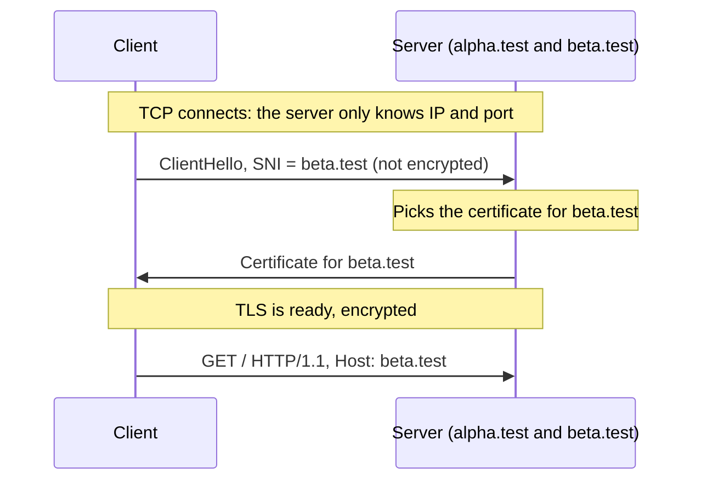

# 06 - SNI (Server Name Indication)

**The problem:** one server hosts `alpha.test` and `beta.test` on the same IP and port. In TLS the server
must send a certificate **before** it receives any HTTP. So it has not seen the `Host` header yet. Which
certificate should it send?

**The solution:** the client writes the name it wants into the very first TLS message, the ClientHello.
That field is SNI.



The name is therefore used in four places:

| Where | Layer | Used for |
|---|---|---|
| DNS question | DNS | Finding the IP |
| SNI | TLS | The server chooses a certificate |
| SAN | Certificate | The client checks the name |
| `Host` header | HTTP | The server chooses the website |

Most SNI problems are two of these not matching.

## Run it: one port, two certificates

Use WSL if `tools/check_setup.py` reported INTERCEPTED.

Terminal 1:
```
python 06-sni/sni_server.py
```
Terminal 2:
```
python 06-sni/sni_client.py
```

Five cases run. Predict each result before you read it:

| Case | SNI | Host | Result |
|---|---|---|---|
| 1 | alpha.test | alpha.test | alpha's certificate, 200 |
| 2 | beta.test | beta.test | beta's certificate, 200 |
| 3 | none | alpha.test | The **default** certificate (name check turned off just to look) |
| 4 | gamma.test | gamma.test | Default certificate, so `Hostname mismatch` |
| 5 | alpha.test | beta.test | TLS is fine, then HTTP 421 |

Cases 3 and 4 are the classic "the server sends me the wrong certificate".

## Run it: read SNI off the wire

```
python 06-sni/show_sni.py
```
```
curl --connect-to ::127.0.0.1:9016 https://my-secret-site.test/
```

The program has no key and no certificate, yet it prints the name. This is how firewalls block sites by
name, and how proxies route HTTPS without decrypting it. (curl reports an error because we hang up.
That is expected.)

## Test SNI with standard tools

`.test` names do not exist in DNS. `--resolve` says "use this IP for this name", so curl sends the right
SNI **and** Host without any DNS or hosts file change:

```
curl --cacert certs/ca.crt --resolve alpha.test:9006:127.0.0.1 https://alpha.test:9006/
curl --cacert certs/ca.crt --resolve beta.test:9006:127.0.0.1  https://beta.test:9006/
openssl s_client -connect 127.0.0.1:9006 -servername beta.test -CAfile certs/ca.crt
```

This is very useful at work: you can test a new server before DNS points to it.

## Try it

1. Predict, then run: `curl --cacert certs/ca.crt --resolve alpha.test:9006:127.0.0.1 -H "Host: beta.test" https://alpha.test:9006/`
   `-H "Host"` changes only HTTP. SNI comes from the URL.
2. Run the `openssl` command with `-noservername` in place of `-servername beta.test`. Which certificate
   appears?
3. Add a site `gamma.test` to `make_certs.py` and `sni_server.py`, until case 4 succeeds.

## Common doubts

**Is SNI encrypted?** Normally not, even in TLS 1.3. Encrypted Client Hello (ECH) hides it where both
sides support it.

**Is SNI sent for plain HTTP?** No. SNI is part of TLS. Plain HTTP has only `Host`.

**Is SNI sent if I use an IP, such as `https://127.0.0.1`?** No. SNI may only contain names, so the server
uses its default certificate. That is why "it works by name but not by IP" happens.

**Why does the proxy reach the server by IP and fail?** A proxy opens a new TLS connection to the server
behind it, with its own SNI. If it sends none, or the wrong name, the server may pick the wrong
certificate or refuse. In nginx see `proxy_ssl_server_name` and `proxy_ssl_name`; other gateways call
it "backend host name" or similar.

**SNI and Host differ: is that allowed?** Technically they are separate values. Some servers allow it;
others answer 421 (Misdirected Request) or 403.

**SNI or a wildcard certificate?** Different things. SNI asks for a name. A wildcard (`*.example.com`)
is a certificate that covers many names, one level deep: `a.example.com` but not `a.b.example.com`.
