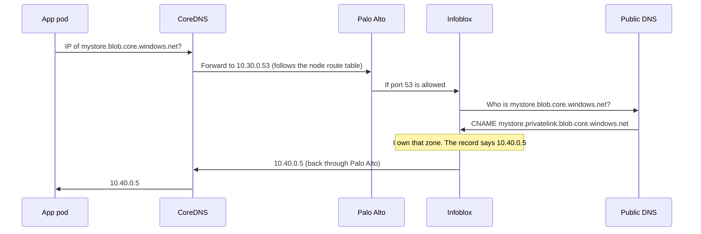
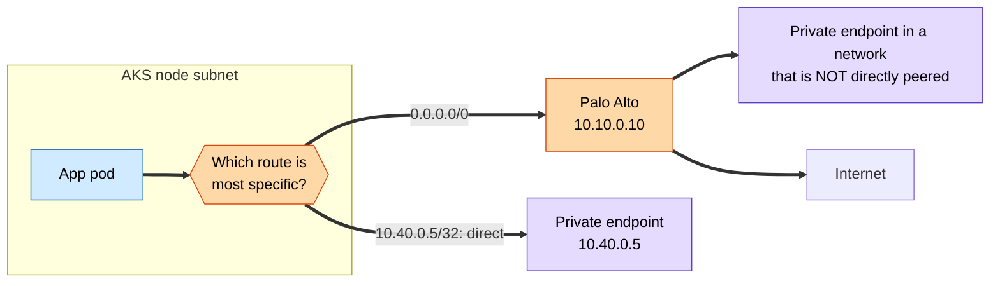

# Doubt: why do we add an Infoblox record for every private endpoint?

> We run AKS. Whenever we create a private endpoint for an Azure resource, we also create a record in
> Infoblox. What does that tell us about DNS and Palo Alto?

**Short answer:** it shows that Infoblox holds the private DNS answers. Creating a private endpoint gives
the resource a **private IP**, but nothing finds that IP until DNS returns it. The record does that. It
does **not** show any special integration between Infoblox and Palo Alto.

A surprise: traffic to a private endpoint often **skips** Palo Alto, even with `0.0.0.0/0` -> Palo Alto on
the node subnet. Section 3 explains why.

Names and addresses are examples: storage account `mystore`, private endpoint IP `10.40.0.5`,
Infoblox `10.30.0.53`, Palo Alto load balancer `10.10.0.10`.

## 1. What the record changes

The application always uses the normal name, `mystore.blob.core.windows.net`. Azure's public DNS makes that
an alias (CNAME) of `mystore.privatelink.blob.core.windows.net`. Who answers the second name decides
where you go:

| Infoblox has | Answer | Result |
|---|---|---|
| Zone `privatelink.blob.core.windows.net` with record `mystore` | `10.40.0.5` | Private endpoint |
| No such zone | A public IP | Goes to the public side; refused if public access is off (often HTTP 403) |
| The zone, but no record for `mystore` | NXDOMAIN | Name not found |
| A record with an old IP | Wrong private IP | Timeout |

The third case can surprise you: once Infoblox owns that zone, a missing record also breaks access to
**someone else's** storage account that uses private endpoints, because its public name points into the
same zone.

## 2. Finding the address

This is the common design: the DNS servers of the cluster network are set to Infoblox. Section 5 shows how
to confirm it for yours.

If Infoblox is in the same network as the nodes or in a directly peered one, the DNS packets skip Palo
Alto, because a built-in route is more specific than `0.0.0.0/0`.

## 3. Reaching the address: is Palo Alto in the path?

A private endpoint adds its own `/32` route to its network and to directly peered networks. `/32` means
exactly one address, so it always beats `0.0.0.0/0`.

| Private endpoint is in | Through Palo Alto? |
|---|---|
| The same virtual network as the nodes | No, the `/32` route wins |
| A directly peered network (for example the hub) | No, the `/32` route wins |
| Another spoke, connected only through the hub | Yes, through `0.0.0.0/0` |
| Any of these, when the network team overrides the `/32` | Yes |

To force it through the firewall, Azure needs both:

1. **Network policy for route tables** enabled on the *private endpoint's* subnet, and
2. a route at least as specific as that virtual network's address range. Example: the network is
   `10.40.0.0/16`, so a route for `10.40.0.0/16` -> `10.10.0.10` works. `0.0.0.0/0` is too broad.

(A `/32` route of your own for the endpoint's IP is the most direct form of 2.) Microsoft also says to use
source NAT (SNAT) on the firewall, so that replies return through it.

Sources: [network policies](https://learn.microsoft.com/azure/private-link/disable-private-endpoint-network-policy),
[inspecting private endpoint traffic](https://learn.microsoft.com/azure/private-link/inspect-traffic-with-azure-firewall).

## 4. Two kinds of record, do not mix them up

| | Ingress record | Private endpoint record |
|---|---|---|
| Example name | `app.corp.example` | `mystore.privatelink.blob.core.windows.net` |
| Points to | Ingress load balancer IP | Private endpoint IP |
| Direction | Others call **your pod** | **Your pod** calls an Azure resource |
| Uses NGINX | Yes | No |

**Why not let Azure do it?** Azure Private DNS zones can create these records automatically, and are read
through the address `168.63.129.16`, which works only from inside Azure virtual networks. Companies that use
Infoblox everywhere, including on-premises, often keep the records there, or have Infoblox forward
these zones to Azure DNS Private Resolver.

**Some resources need more than one record:**

| Resource | Records |
|---|---|
| Storage | One private endpoint and zone per service: blob, file, queue, table, web, dfs |
| Container Registry | The registry **and** its regional data endpoint |
| Web App | The app **and** its SCM (deployment) site |

Azure lists the exact names: open the private endpoint and look at **DNS configuration**.

## 5. Prove it

Run the first two from your PC and from a pod. Compare the answers.

| Question | Command | Good result |
|---|---|---|
| What does my normal DNS say? | `nslookup mystore.blob.core.windows.net` | Private IP |
| What does Infoblox say? | `nslookup mystore.blob.core.windows.net 10.30.0.53` | The same private IP |
| What does a pod see? | `kubectl run t --rm -it --restart=Never --image=busybox:1.36 -- nslookup mystore.blob.core.windows.net` | The same private IP |
| Does the pod network use Infoblox? | `az network vnet show -g <group> -n <vnet> --query dhcpOptions.dnsServers` | Infoblox IPs. Empty = Azure's own DNS |
| Where does CoreDNS forward? | `kubectl -n kube-system get cm coredns coredns-custom -o yaml` | `/etc/resolv.conf` or Infoblox IPs |
| What is the true endpoint IP? | `az network private-endpoint show -g <group> -n <name> --query customDnsConfigs` (or DNS configuration in the portal) | Matches the DNS answer |
| Which route do nodes use? | Portal: node network interface > Effective routes (for scale sets, through the instance) | A `/32` of type `InterfaceEndpoint` = skips Palo Alto |

| Symptom | Likely cause |
|---|---|
| Public IP returned | Infoblox record or zone missing, or this client does not use Infoblox |
| NXDOMAIN | The zone exists in Infoblox, the record does not |
| Works on your PC, not in the pod | Different DNS servers, or CoreDNS cache |
| Private IP returned, then timeout | Old IP, network security group, or Palo Alto rule |
| Worked, then broke after the endpoint was recreated | The IP changed and Infoblox has the old one |
| Certificate name error | You connected by IP or by the `privatelink` name. Use the normal name |

The last row is [lesson 06](../06-sni/) again: the certificate is for the normal name, so connect with
that name.

## 6. What to ask the network team

1. Are the DNS servers on the AKS virtual network set to Infoblox directly, or to something that forwards to it?
2. In Infoblox, do we own the `privatelink.*` zones, or are single names overridden?
3. Is the private endpoint in our spoke, the hub or another spoke?
4. Is private endpoint traffic meant to be inspected by Palo Alto?
5. Does Palo Alto itself use Infoblox to resolve hostnames in its rules?
