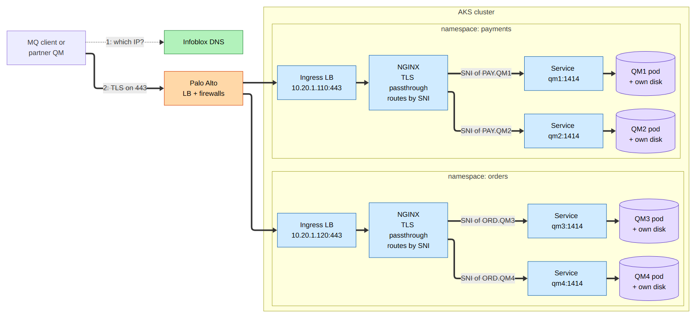
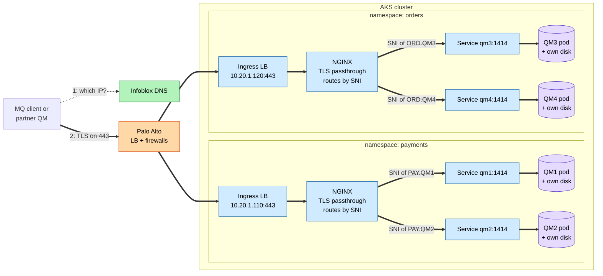
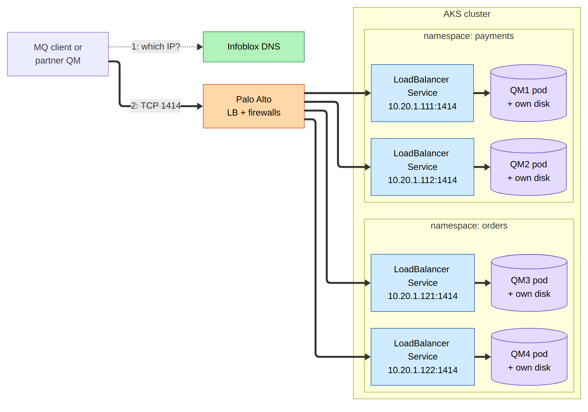
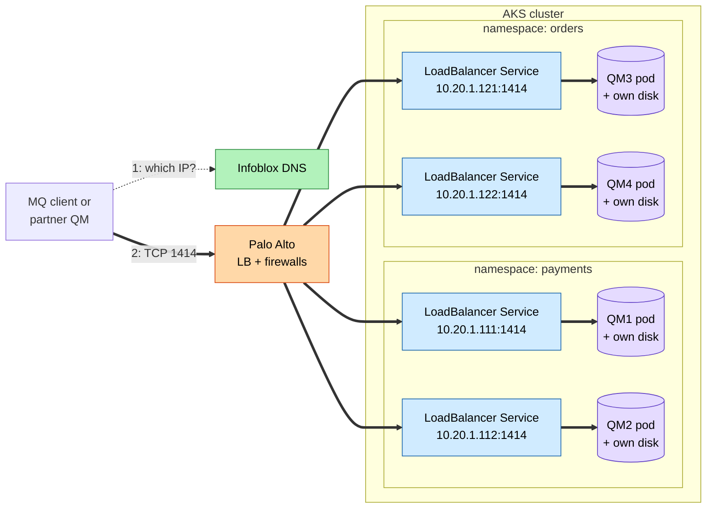
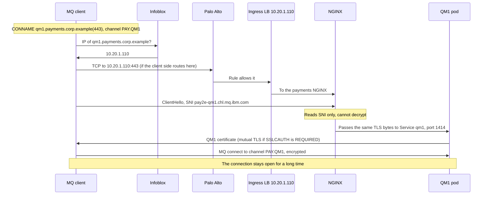

# Doubt: many IBM MQ queue managers on AKS, each with its own hostname

> One cluster, several namespaces, several queue manager (QM) pods in each namespace, with their own
> ingress load balancer. How does a client reach the right one?

**Short answer:** Infoblox finds the load balancer IP, Palo Alto allows the port, and then something must
choose the queue manager. MQ is **not HTTP**, so there is no `Host` header to choose by. The choice is made
by **SNI** (design A) or by **IP address** (design B).

All names and addresses are examples.

## Three ways MQ differs from a web app

1. **Queue managers are not interchangeable.** Any copy of a web pod can answer. A message in QM1 exists
   only in QM1, so a load balancer must never spread one address over *different* queue managers.
2. **MQ is its own protocol on TCP, usually port 1414.** Ordinary Ingress rules (hostname and path) only
   work for HTTP, such as the MQ web console.
3. **MQ's SNI is unusual.** By default an MQ client using TLS sends the **channel name**, encoded, rather than
   the hostname it connected to (section 3).

## 1. Design A: one ingress load balancer per namespace

All queue managers in a namespace share one IP. NGINX reads the SNI and passes the TLS connection on without
decrypting it (**TLS passthrough**).



<details>
<summary>Editable diagram source (Mermaid)</summary>



</details>

| Infoblox record | IP |
|---|---|
| `qm1.payments.corp.example`, `qm2.payments.corp.example` | `10.20.1.110` (same) |
| `qm3.orders.corp.example`, `qm4.orders.corp.example` | `10.20.1.120` (same) |

## 2. Design B: one load balancer per queue manager

No NGINX in the MQ path. Each QM has a Service of `type: LoadBalancer` with its own IP, so the IP alone
identifies the QM and SNI is not needed for routing.



<details>
<summary>Editable diagram source (Mermaid)</summary>



</details>

### Which one?

| | A: shared, by SNI | B: one IP per QM |
|---|---|---|
| IPs used | One per namespace | One per queue manager |
| Palo Alto rules | Fewer; cannot separate QMs by IP | One IP per QM, easy to restrict |
| TLS | Required | Recommended, but not needed for routing |
| Channel names | Must be unique behind one NGINX | No rule |
| Extra part to run | NGINX (or a similar router) | None |
| Support in the IBM sample Helm chart | Its Ingress option covers only the web console | Yes: `route.loadBalancer.mqtraffic` |

A third way is NGINX with **one TCP port per QM** (1414, 1415, ...), through its `tcp-services` ConfigMap. No
SNI is needed, but every port needs a firewall rule.

> **Check your NGINX version.** The community Ingress NGINX project stopped releasing fixes in March 2026, and
> Microsoft's patches for NGINX in the AKS application routing add-on end in November 2026. Existing
> installations keep working but get no security fixes. Other NGINX products are not affected. For SNI
> routing, look at [Envoy with Gateway API](ibm-mq-with-envoy.md) or design B.

## 3. The SNI surprise

You connect to `qm1.payments.corp.example` on channel `PAY.QM1`. The SNI is **not** that hostname:

| Channel | SNI sent by default |
|---|---|
| `PAY.QM1` | `pay2e-qm1.chl.mq.ibm.com` |
| `ORD.QM3` | `ord2e-qm3.chl.mq.ibm.com` |
| `pay.qm1` | `70-61-79-2e-71-6d-1.chl.mq.ibm.com` |

Rule: capital letters become small, digits stay, and everything else becomes its two-digit hex code and a
hyphen. A dot is `2e-`. So **use capital letters** in channel names, and end with a capital letter or digit;
otherwise the name ends in a hyphen and is not a valid hostname.

| | Used for | Who must know it |
|---|---|---|
| `qm1.payments.corp.example` | Finding the IP | Infoblox |
| `pay2e-qm1.chl.mq.ibm.com` | Choosing the QM | NGINX rule (and any Palo Alto SNI filter) |

The SNI name needs **no DNS record**. Nobody looks it up.

Changing it: the client setting `OutboundSNI=HOSTNAME` (MQ 9.2.1 and later clients) sends the hostname
instead. But then the channel cannot have its own certificate (`CERTLABL`): MQ rejects it with
`MQRC_SSL_INITIALIZATION_ERROR` and logs `AMQ9673`. If the client connects by IP address, the SNI is blank.

An Ingress for QM1 in design A (the NGINX controller also needs `--enable-ssl-passthrough`):

```yaml
apiVersion: networking.k8s.io/v1
kind: Ingress
metadata:
  name: qm1-mq
  namespace: payments
  annotations:
    nginx.ingress.kubernetes.io/ssl-passthrough: "true"
spec:
  ingressClassName: nginx-payments        # this namespace's own controller
  rules:
    - host: pay2e-qm1.chl.mq.ibm.com      # the SNI, not the DNS name
      http:
        paths:
          - path: /
            pathType: Prefix
            backend:
              service:
                name: qm1
                port:
                  number: 1414
```

With several channels to one QM, each channel name needs its own `host` entry.

## 4. One connection, step by step (design A)



## 5. Who talks to whom?

| From | To | Address to use | Passes ingress / Palo Alto? |
|---|---|---|---|
| App in the same namespace | QM1 | `qm1(1414)` | No / No |
| App in another namespace | QM1 | `qm1.payments.svc.cluster.local(1414)` | No / No |
| QM3 to QM1, same cluster | QM1 | `qm1.payments.svc.cluster.local(1414)` | No / No |
| On-premises app or partner QM | QM1 | `qm1.payments.corp.example(443)` in A, `(1414)` in B | Yes (A) / if routed |
| QM1 to a partner QM outside | Partner | Their hostname and port | No / Yes, by the node route table |
| Admin browser | Web console | HTTPS hostname, Service port 9443 | Yes / if routed |

Namespaces do not block each other by themselves. Use **NetworkPolicy** if `orders` must not reach `payments`.

For messages in **both** directions between QM1 and a partner, two separate channels are normally used, one
inbound and one outbound. They take different paths and need separate firewall rules.

## 6. High availability

With **Native HA**, one queue manager runs as three pods: one active and two replicas, each with its own disk.
Only the active pod becomes ready, so the Service sends traffic only to it. It is still **one** queue manager,
so the diagrams do not change. After a failover clients must **reconnect**; the hostname and IP stay the same.

## 7. The idle timeout trap

| Part | Default |
|---|---|
| MQ channel heartbeat (`HBINT`) | 300 seconds (5 minutes) |
| Azure load balancer idle timeout | 4 minutes (check the value on yours) |

If nothing is sent for 4 minutes, the load balancer may drop the connection **before** the first heartbeat.
MQ then reports broken connections that "happen when it is quiet". NGINX and Palo Alto have idle
timeouts too. Keep the heartbeat shorter than the shortest of them:

```
ALTER CHANNEL(PAY.QM1) CHLTYPE(SVRCONN) HBINT(120)
```

Both ends agree on a value, so set it on the client side as well. The load balancer's timeout can be raised
with the Service annotation `service.beta.kubernetes.io/azure-load-balancer-tcp-idle-timeout` (minutes).

## 8. Prove it

| Question | Command |
|---|---|
| Which IPs do the load balancers have? | `kubectl get svc -A` (look for `LoadBalancer`) |
| Which SNI names does NGINX know? | `kubectl get ingress -A` |
| Does Infoblox return the right IP? | `nslookup qm1.payments.corp.example 10.30.0.53` |
| Is the port reachable? (Windows) | `Test-NetConnection qm1.payments.corp.example -Port 443` |
| Does SNI reach the right QM? (A) | `openssl s_client -connect 10.20.1.110:443 -servername pay2e-qm1.chl.mq.ibm.com` and look at the certificate |
| Does the QM work without the network? | `kubectl -n payments exec <pod> -- dspmq` |
| Which channels are running? | `kubectl -n payments exec <pod> -- bash -c "echo 'DISPLAY CHSTATUS(*)' \| runmqsc QM1"` |

| Symptom | Look at |
|---|---|
| 2538 host not available | DNS, Palo Alto rule, wrong port, listener not running |
| 2059 queue manager not available | QM down, or the wrong QM name at this address |
| 2393 SSL initialization error | Certificates, cipher, SNI, `CERTLABL` with `OutboundSNI=HOSTNAME` |
| 2035 not authorized | The network is fine. MQ user, CHLAUTH or CONNAUTH rules |
| 2009 connection broken | Idle timeout (section 7), failover, pod restart |
| NGINX default certificate appears | The SNI matches no Ingress rule, or passthrough is off |
| Works inside the cluster, not outside | Ingress, load balancer, Palo Alto or DNS |

Like an HTTP status code, **2035 is good news for the network**: the queue manager received you and said no.

## Sources

- IBM: [channel name to SNI](https://www.ibm.com/support/knowledgecenter/en/SSFKSJ_9.2.0/com.ibm.mq.sec.doc/q135250_.html),
  [OutboundSNI and routes](https://www.ibm.com/docs/SSFKSJ_9.2.0/container/cc_conn_qm_openshift.html),
  [HBINT](https://www.ibm.com/support/knowledgecenter/SSFKSJ_9.1.0/com.ibm.mq.ref.con.doc/q081890_.htm),
  [sample Helm chart](https://github.com/ibm-messaging/mq-helm/blob/main/charts/ibm-mq/README.md)
- NGINX: [TLS passthrough](https://kubernetes.github.io/ingress-nginx/user-guide/tls/),
  [TCP services](https://kubernetes.github.io/ingress-nginx/user-guide/exposing-tcp-udp-services/),
  [retirement](https://kubernetes.io/blog/2025/11/11/ingress-nginx-retirement/)
- Azure: [application routing add-on](https://learn.microsoft.com/azure/aks/app-routing),
  [idle timeout](https://learn.microsoft.com/azure/load-balancer/load-balancer-tcp-idle-timeout)
