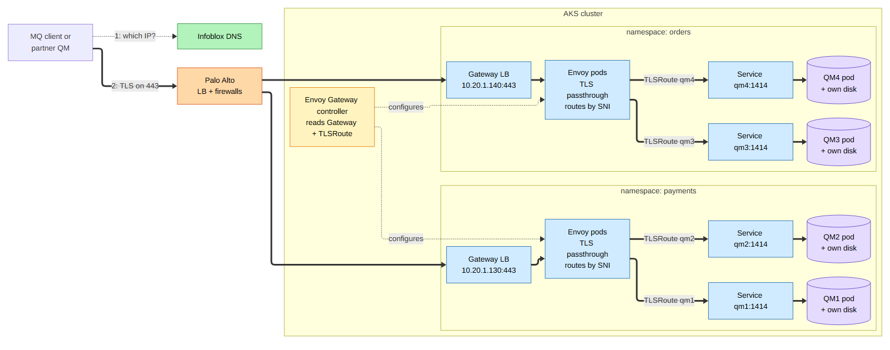
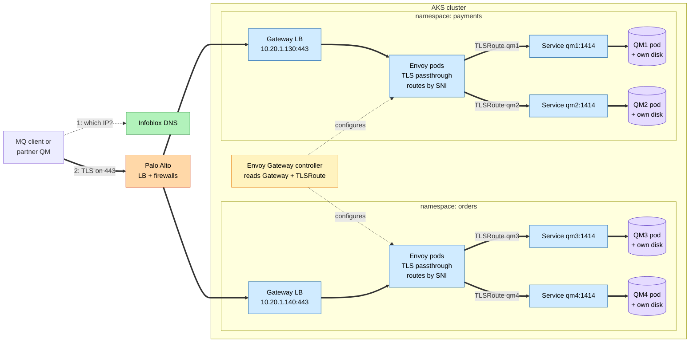
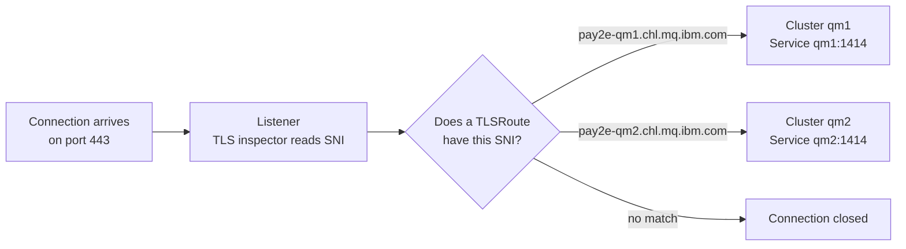

# Doubt: IBM MQ on AKS with Envoy instead of NGINX ingress

> The same setup as [IBM MQ on AKS](ibm-mq-on-aks.md), but with Envoy choosing the queue manager.

**Short answer:** yes, and it suits MQ better than NGINX Ingress. Envoy with **Gateway API** has real objects for
TLS passthrough (`TLSRoute`) and TCP (`TCPRoute`), so no HTTP-style Ingress rule has to be bent into shape.
Infoblox, Palo Alto, the route table, the queue managers and MQ's unusual SNI **do not change**.

Read the [first MQ page](ibm-mq-on-aks.md) before this one. All names and addresses are examples.

## 1. The names, sorted out

| Name | What it is | Compare with |
|---|---|---|
| **Envoy** | The proxy program that carries the traffic | The NGINX process |
| **Gateway API** | Standard Kubernetes objects: `Gateway`, `TLSRoute`, ... | The `Ingress` object |
| **Envoy Gateway** | A controller that reads those objects, then creates and configures Envoy | The NGINX Ingress Controller |
| **Istio** | Another controller that also uses Envoy; it adds a service mesh | - |

Two separate jobs matter here. The **control plane** (Envoy Gateway) only writes configuration. The **data plane**
(the Envoy pods) carries MQ traffic.

| NGINX Ingress | Envoy with Gateway API |
|---|---|
| `IngressClass` | `GatewayClass` |
| Controller + its load balancer, installed per namespace | One `Gateway` per namespace; each gets its own Envoy and load balancer |
| `Ingress` with the `ssl-passthrough` annotation | `TLSRoute` |
| `--enable-ssl-passthrough` controller flag | `tls.mode: Passthrough` on the listener |
| `tcp-services` ConfigMap | `TCPRoute` |
| Service annotations in Helm values | `EnvoyProxy` object |
| Timeout annotations | `ClientTrafficPolicy`, `BackendTrafficPolicy` |

## 2. The picture



<details>
<summary>Editable diagram source (Mermaid)</summary>



</details>

MQ traffic never goes through the yellow controller. If it stops, Envoy keeps running with its last
configuration; only changes wait.

> **The picture needs one setting.** By default Envoy Gateway puts all Envoy pods and load balancer Services in
> *its own* namespace (`envoy-gateway-system`), even though each Gateway still has its own. To have them inside
> `payments` and `orders` as drawn, turn on **Gateway Namespace Mode**:
> `config.envoyGateway.provider.kubernetes.deploy.type=GatewayNamespace` in the Helm values. It cannot be
> combined with merged Gateways. NetworkPolicies must allow Envoy from wherever it runs.

## 3. How Envoy decides



Envoy's own words: a **listener** accepts, a **filter chain** matches, a **cluster** is the destination. (An Envoy
"cluster" is a group of backends, not a Kubernetes cluster.) See it without Kubernetes in
[envoy-plain.yaml](envoy-mq/envoy-plain.yaml), which has comments on every part. It is
[lesson 06](../06-sni/) as a product: [show_sni.py](../06-sni/show_sni.py) is a tiny TLS inspector.

## 4. The Kubernetes objects

Full file: [gateway.yaml](envoy-mq/gateway.yaml). The two important parts:

```yaml
kind: Gateway            # apiVersion: gateway.networking.k8s.io/v1
spec:
  gatewayClassName: eg
  listeners:
    - name: mq-tls
      protocol: TLS
      port: 443
      tls:
        mode: Passthrough                  # read SNI, do not decrypt
      allowedRoutes:
        namespaces:
          from: Same                       # "orders" cannot attach routes here
---
kind: TLSRoute           # apiVersion: gateway.networking.k8s.io/v1
spec:
  parentRefs:
    - name: payments-mq
      sectionName: mq-tls
  hostnames:
    - pay2e-qm1.chl.mq.ibm.com             # SNI of channel PAY.QM1, not the DNS name
  rules:
    - backendRefs:
        - name: qm1
          port: 1414
```

Add one `hostnames` line for each channel of the queue manager. A route to a Service in another namespace
also needs a `ReferenceGrant` there, so one team cannot quietly route to another team's queue manager.

Installing Envoy Gateway (v1.10 supports Kubernetes 1.34 to 1.37):

```
helm install eg oci://docker.io/envoyproxy/gateway-helm --version v1.10.0 \
  -n envoy-gateway-system --create-namespace \
  --set config.envoyGateway.provider.kubernetes.deploy.type=GatewayNamespace
kubectl apply -f doubts/envoy-mq/gateway.yaml
```

## 5. Other ways to choose the queue manager

| Design | Objects | Chooses by | Use when |
|---|---|---|---|
| **E1** (drawn above) | One Gateway per namespace, `TLSRoute` per QM | SNI | Many QMs, few IPs, all clients use TLS |
| **E2** | One Gateway per namespace, one listener port and `TCPRoute` per QM | Port | Clients without TLS or with awkward channel names |
| **E3** | One Gateway per QM | IP address | Firewall rules per QM, but you still want Envoy's metrics |
| **B** (no proxy) | `type: LoadBalancer` Service per QM | IP address | Few QMs: the fewest moving parts |

E3 works like B with an extra hop. Choose it only if Envoy gives you something you need. `TCPRoute` became part
of the Standard channel in Gateway API v1.6, and `TLSRoute` in v1.5.

## 6. Behaviour that matters for MQ

| Topic | Envoy Gateway default | What it means for MQ |
|---|---|---|
| Idle timeout (TCP/TLS listener) | 1 hour | Fine. The Azure load balancer (4 minutes) is still the shortest |
| TCP keepalive | Off | `ClientTrafficPolicy` turns it on towards clients (2 minutes in our file) |
| MQ heartbeat `HBINT` | 300 s (an MQ default) | **Still set it lower**, for example 120. Keepalive covers only one hop |
| `externalTrafficPolicy` | `Local` | Only nodes with an Envoy pod receive traffic, so run at least two |
| Shutdown drain | Up to 60 s | See below |

**Upgrades cut connections.** For HTTP, a proxy can finish a request and move on. An MQ connection stays open for
hours, and Envoy cannot move it to another pod. When an Envoy pod is upgraded, rescheduled or scaled in, its MQ
connections are closed, at the latest after the drain time. (NGINX has the same problem.) So:

- Enable **automatic client reconnect**, and let channels between queue managers retry.
- Change Envoy in a quiet period, and add a PodDisruptionBudget.
- Be careful with autoscaling Envoy, because scaling in closes connections.

**Uneven load is normal.** Connections stay on the Envoy pod where they started.

**The queue manager sees Envoy's address** as the client, not the real one. MQ `CHLAUTH` rules that use IP addresses
(`ADDRESSMAP`) therefore stop being useful. Use certificates (`SSLPEERMAP`) instead. With passthrough, mutual
TLS still works end to end, because Envoy never opens it.

## 7. Which Envoy on AKS?

| Option | Who runs it | Remarks |
|---|---|---|
| **Envoy Gateway** (this page) | You | Clear TLS passthrough support; you own upgrades. Releases have fixed end dates (v1.10: May 2027) |
| **AKS application routing, Gateway API** | Microsoft | Runs Istio. Its documentation shows HTTP routes only and does not mention `TLSRoute`: **ask Microsoft or test first** |
| **Istio** (AKS add-on or your own) | Microsoft / you | Makes sense if you already use a mesh |

Do not let two products install the **Gateway API CRDs** (the object definitions). Microsoft's page says that
self-managed CRDs are not supported with its managed implementation. Check what exists first:
`kubectl get crd | grep gateway.networking.k8s.io`

## 8. NGINX or Envoy for MQ?

| | NGINX Ingress (community) | Envoy Gateway |
|---|---|---|
| Security fixes | Ended March 2026 | Active |
| TLS passthrough | Extra: controller flag + annotation | A normal, standard object |
| Own load balancer per namespace | Install a controller each time | One `Gateway` object |
| Protection between teams | Anyone may claim a hostname on the shared class | `allowedRoutes`, `ReferenceGrant` |
| Error messages | Read controller logs | `status` on every object |
| New things to learn | Little, if you know Ingress | Gateway API and Envoy words |

**My recommendation:** few queue managers: design B, no proxy. Many queue managers or few IPs: E1.

## 9. Moving without a big bang

1. Install Envoy Gateway **beside** NGINX. The new Gateway gets a **new IP**.
2. Palo Alto: allow the new IP on 443.
3. Test before any DNS change, with the new IP and the right SNI:
   `openssl s_client -connect 10.20.1.130:443 -servername pay2e-qm1.chl.mq.ibm.com`
4. Infoblox: lower the TTL of **one** queue manager's name, wait for the old TTL to pass, and change its IP.
5. Connected clients **stay on NGINX** until they reconnect. Restart channels when it suits you.
6. Check that no connection uses the old path, then repeat for the next queue manager.
7. Remove NGINX last. Going back means changing the Infoblox record back.

## 10. Prove it

| Question | Command |
|---|---|
| Did the Gateway get an IP? | `kubectl get gateway -A` (look at `ADDRESS` and `PROGRAMMED`) |
| Was the route accepted? | `kubectl -n payments describe tlsroute qm1` (`Accepted`, `ResolvedRefs`) |
| Where are the Envoy pods and Service? | `kubectl get pods,svc -A -l gateway.envoyproxy.io/owning-gateway-name=payments-mq` |
| Does SNI reach QM1? | The `openssl` command above; look at the certificate subject |
| What if the SNI is unknown? | Same command with `-servername wrong.example`: the connection closes |
| Plain Envoy config correct? | The `docker run ... --mode validate` line in `envoy-plain.yaml` |

| Symptom | Look at |
|---|---|
| `ADDRESS` stays empty | Load balancer Service events, internal LB annotation, free IPs in the subnet |
| Gateway not `Accepted` | `GatewayClass` name, Envoy Gateway running? |
| Route not `Accepted` | `parentRefs`, `sectionName`, `allowedRoutes` |
| `ResolvedRefs` is False | Service name or port, missing `ReferenceGrant` |
| Connection closes at once | SNI matches no route: channel name, `OutboundSNI`, client without TLS |
| Connects, then 2035 | The network is fine: MQ authorization, or `CHLAUTH` with the old client IP |
| Breaks after about 4 quiet minutes | Keepalive and `HBINT` (section 6) |
| Breaks during Envoy upgrades | Expected: client reconnect (section 6) |

## What was checked

`gateway.yaml` passes the object schemas published with Envoy Gateway v1.10.0. `envoy-plain.yaml` is accepted by Envoy
1.36's own validator. Neither has carried real MQ traffic yet, so try them in a test cluster first.

Sources: [Envoy Gateway TLS passthrough](https://gateway.envoyproxy.io/docs/tasks/security/tls-passthrough/),
[deployment mode](https://gateway.envoyproxy.io/docs/tasks/operations/deployment-mode/),
[namespace mode](https://gateway.envoyproxy.io/docs/tasks/operations/gateway-namespace-mode/),
[graceful shutdown](https://gateway.envoyproxy.io/docs/tasks/operations/graceful-shutdown/),
[versions](https://gateway.envoyproxy.io/news/releases/matrix/),
[timeouts in the source](https://raw.githubusercontent.com/envoyproxy/gateway/main/api/v1alpha1/timeout_types.go),
[Gateway API TLS](https://gateway-api.sigs.k8s.io/guides/tls-routing/),
[v1.5](https://kubernetes.io/blog/2026/04/21/gateway-api-v1-5/) and
[v1.6](https://kubernetes.io/blog/2026/08/03/gateway-api-v1-6-release/),
[AKS application routing Gateway API](https://learn.microsoft.com/azure/aks/app-routing-gateway-api)
