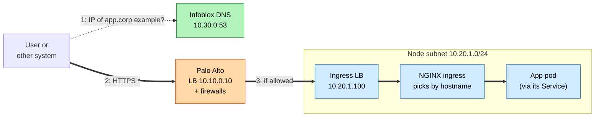
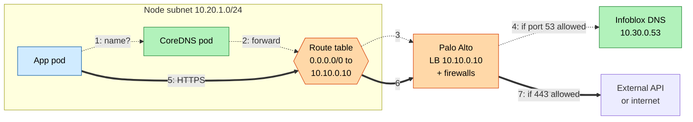
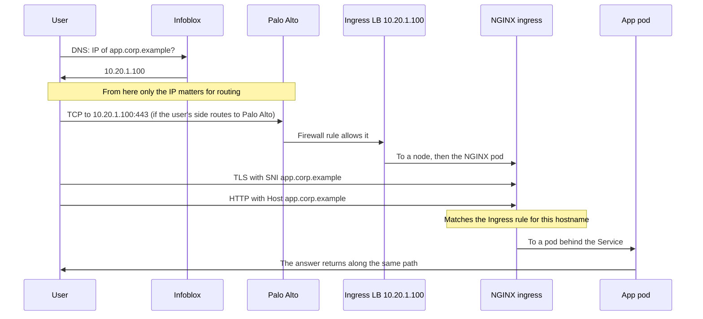
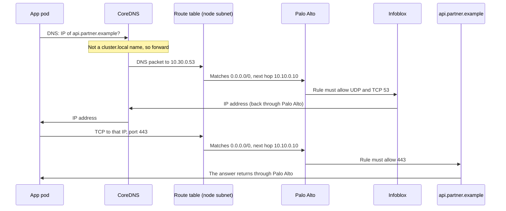
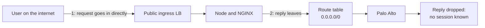

# Doubt: pod, NGINX ingress, route table, Palo Alto and Infoblox

> The node subnet has a route table that points to the load balancer of the Palo Alto firewalls. Does
> that mean the traffic goes through Palo Alto? And where does Infoblox fit?

**Short answer:** traffic **leaving** the nodes goes through Palo Alto, if its destination matches that
route. The route table says nothing about how traffic **comes in**. Infoblox answers "which IP has this
name?"; application traffic does not pass through it.

This is for AKS (Azure). The names and addresses are examples.

| Thing | Example |
|---|---|
| Hostname | `app.corp.example` |
| Ingress load balancer IP | `10.20.1.100` |
| Node subnet | `10.20.1.0/24` |
| Palo Alto internal load balancer IP | `10.10.0.10` |
| Infoblox DNS IP | `10.30.0.53` |
| Route on the node subnet | `0.0.0.0/0` -> `10.10.0.10` |

## 1. The map

Solid arrows carry application traffic. Dotted arrows carry DNS. Orange is the firewall, green is DNS,
blue is the cluster.

### A. Inbound: a user opens your app

\* Only if the user's side routes to Palo Alto, or the app is published on it. The node route table does
not decide this.

### B. Outbound: your pod calls something

## 2. Inbound, step by step

Here TLS passes through Palo Alto unopened and NGINX holds the certificate. If Palo Alto does TLS
decryption, there are two TLS connections instead (see [lesson 05](../05-https/)).

- Every hostname on this ingress controller normally has the **same IP**. NGINX separates them by
  SNI and `Host` ([lesson 06](../06-sni/)). Your own Ingress and hostname do not mean your own IP.
- What sends inbound traffic to Palo Alto is the **other side**: a route on the user's, VPN or on-premises
  side, or a public IP on Palo Alto that translates (DNAT) to `10.20.1.100`.

## 3. Outbound, step by step

- Two firewall permissions are needed: **DNS first, then the real traffic**.
- With an overlay pod network, Palo Alto usually sees the **node's IP** as the source, not the pod's.
- CoreDNS only reaches Infoblox if it forwards there. Usually it copies the node's DNS servers. If those are
  still the cloud's built-in DNS (Azure: `168.63.129.16`), those lookups do **not** follow your route table.

## 4. What goes through Palo Alto?

A route table looks only at the **destination IP** of packets **leaving** the subnet. The most specific
route wins, and it never sees hostnames.

| Traffic | Through Palo Alto? | Why |
|---|---|---|
| Pod to internet | Yes | Only `0.0.0.0/0` matches |
| Pod to on-premises or Infoblox | Usually | Unless a more specific route exists (peering, VPN) |
| Pod to pod, same cluster | No | Stays inside the cluster network |
| Pod to another subnet, same network | Usually no | The built-in network route is more specific than `0.0.0.0/0` |
| Pod to CoreDNS | No | Inside the cluster |
| Pod to a private endpoint | **Often no** | It has its own `/32` route: see [private endpoints](aks-private-endpoint-infoblox.md) |
| User to ingress | **Not decided by this route table** | Decided by the route or DNAT on the user's side |

## 5. The trap: in by one door, out by another

Palo Alto never saw the request, so it does not recognise the reply. The user sees a **timeout**, although
DNS, NGINX and the pod are all healthy. This is **asymmetric routing**. The fix is to make both directions
use Palo Alto: give the ingress an internal IP and publish it through Palo Alto with DNAT.

Several firewalls behind a load balancer need the same care: both directions must reach the **same**
firewall, which is often ensured with source NAT (SNAT).

## 6. "Infoblox is integrated with Palo Alto" can mean four things

| Meaning | What happens | Effect |
|---|---|---|
| Infoblox is behind Palo Alto | DNS packets cross the firewall | Needs a rule for port 53 |
| Palo Alto is a DNS proxy | Clients ask Palo Alto, it asks Infoblox | DNS server setting is a Palo Alto IP |
| Palo Alto resolves FQDN objects with Infoblox | Rules such as "allow api.partner.example" become IPs | Wrong if pods and Palo Alto get different answers |
| Threat or inventory data is shared | Infoblox sends bad domains/IPs or IP details to Palo Alto | Firewall rules use that data; no traffic path changes |

Ask your network team which one applies. It decides where to look when DNS fails.

## 7. Prove it on your cluster

| Question | Command |
|---|---|
| Which IP does Infoblox give? | `nslookup app.corp.example 10.30.0.53` |
| Is it the ingress IP? | `kubectl get ingress -A` and `kubectl get svc -A` |
| Where does CoreDNS forward? | `kubectl -n kube-system get configmap coredns -o yaml` (look at `forward`) |
| Can a pod resolve names? | `kubectl run t --rm -it --restart=Never --image=busybox:1.36 -- nslookup api.partner.example` |
| Does NGINX work without DNS? | `curl -v --resolve app.corp.example:443:10.20.1.100 https://app.corp.example/` |
| Which route is used? (Azure) | `az network nic show-effective-route-table -g <group> -n <node-nic> -o table` (VM scale set nodes need `az vmss nic` details or the portal) |
| Did Palo Alto see it? | Palo Alto: Monitor > Logs > Traffic, filter by source and destination IP |

How to read the results:

| Symptom | Look at |
|---|---|
| NXDOMAIN | The record in Infoblox, or the wrong DNS server |
| DNS query times out | Port 53 rule on Palo Alto, or the route to Infoblox |
| Name resolves, TCP times out | Palo Alto rule, route, or asymmetric routing (section 5) |
| Wrong certificate | SNI does not match an Ingress TLS entry |
| NGINX 404 | No Ingress rule for this hostname or path |
| 502 / 503 / 504 from NGINX | The Service or pods behind it |
